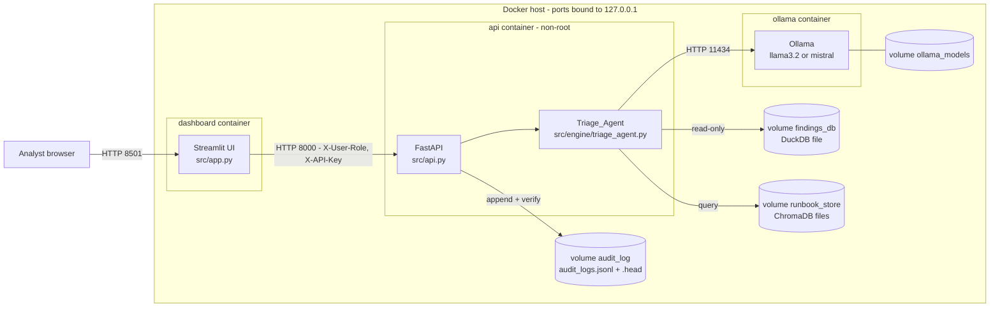
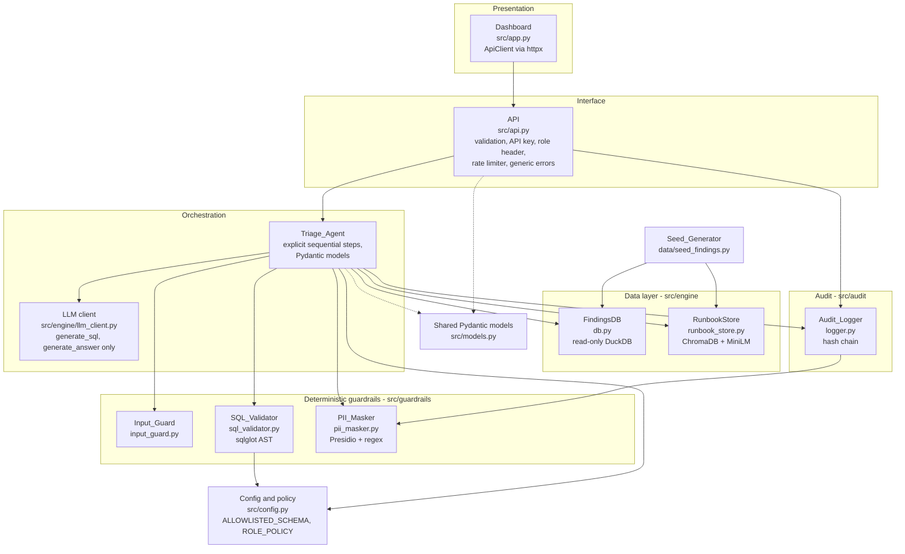
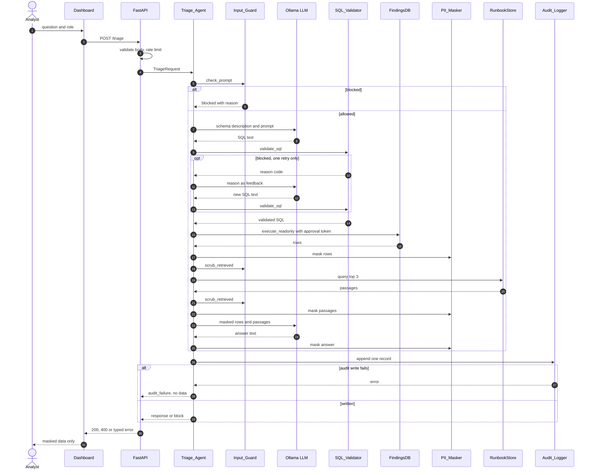
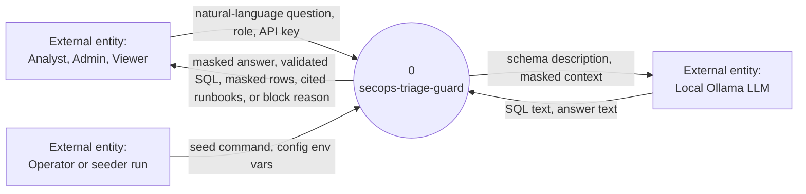
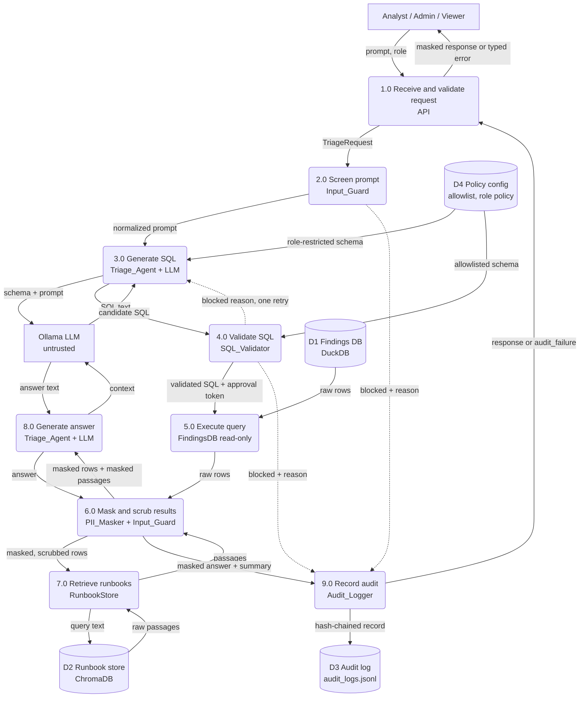
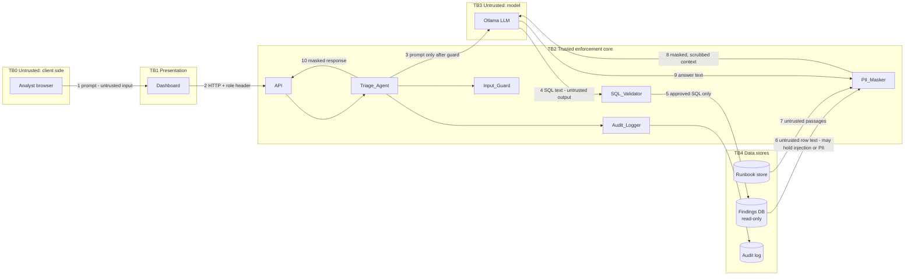
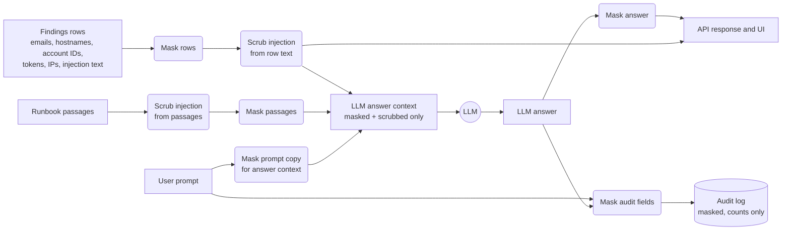
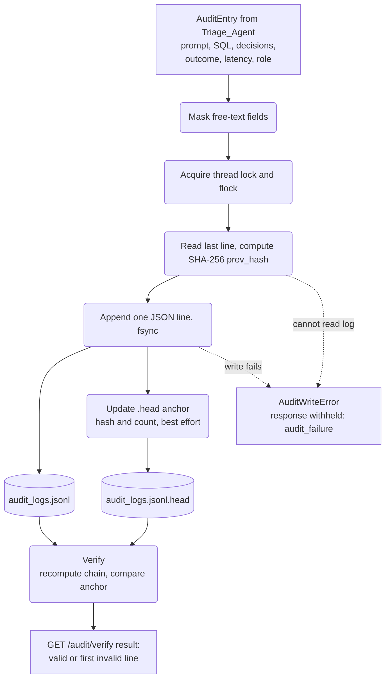
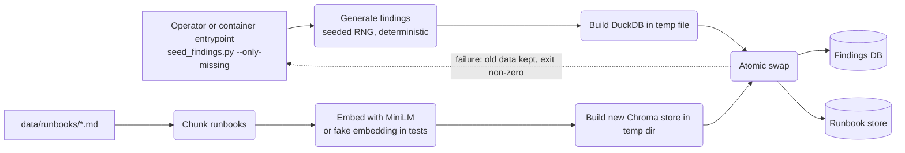

# secops-triage-guard: Technical Architecture and Data Flow Diagrams

This document describes the implemented system. File paths refer to this repository.

## 1. Design principle

The LLM is an untrusted component. It can only emit SQL text and answer text. Everything it receives and everything it emits passes through deterministic, non-LLM controls (input guard, SQL validator, read-only database, masker, audit log). Every control fails closed.

## 2. Technical architecture

### 2.1 Deployment view (Docker Compose)

### 2.2 Component view

### 2.3 Component responsibilities

| Component | File | Responsibility |
|---|---|---|
| Dashboard | `src/app.py` | Chat, SQL view, masked-vs-blocked telemetry, audit viewer. Talks only to the API. |
| API | `src/api.py` | `POST /triage`, `GET /audit`, `GET /audit/verify`, `GET /health`. Pydantic validation, 30 req/min rate limit, optional `X-API-Key`, `X-User-Role` check, generic 500s. |
| Triage_Agent | `src/engine/triage_agent.py` | Runs the ten-step pipeline and writes exactly one audit record per request. |
| LLM client | `src/engine/llm_client.py` | LangChain `ChatOllama`, no tools, 60 s limit, errors become `LLMUnavailable`. |
| Input_Guard | `src/guardrails/input_guard.py` | Normalizes prompts, blocks injection, exfiltration, write intent, jailbreaks. Scrubs retrieved text. |
| SQL_Validator | `src/guardrails/sql_validator.py` | Single SELECT only, allowlisted tables and columns, no file or catalog access, LIMIT clamp. |
| PII_Masker | `src/guardrails/pii_masker.py` | Presidio plus regex rules, typed `[REDACTED:TYPE]` placeholders, idempotent. |
| FindingsDB | `src/engine/db.py` | Read-only DuckDB connection with external access disabled, 10 s timeout, approval token, sanitized errors. |
| RunbookStore | `src/engine/runbook_store.py` | File-backed ChromaDB, all-MiniLM-L6-v2 embeddings, top-k retrieval. |
| Audit_Logger | `src/audit/logger.py` | Append-only JSONL, SHA-256 hash chain, `.head` anchor, locked writes, masked fields. |
| Config | `src/config.py` | Environment settings, the single allowlisted schema, role policy. |
| Seed_Generator | `data/seed_findings.py` | Deterministic synthetic findings with fake PII, secrets and injection payloads. Loads the DB and runbook store. |

### 2.4 Request sequence

### 2.5 Technology stack

| Concern | Choice |
|---|---|
| Language | Python 3.11+ |
| LLM | Ollama, llama3.2 or mistral (set by `LLM_MODEL`), via `langchain-ollama` |
| Database | DuckDB, opened read-only |
| Vector store | ChromaDB with sentence-transformers all-MiniLM-L6-v2 |
| SQL guardrail | sqlglot AST parsing |
| Masking | Microsoft Presidio (analyzer and anonymizer) plus regex |
| API and UI | FastAPI, Streamlit |
| Validation | Pydantic, pydantic-settings |
| Tests | pytest, Hypothesis |
| Packaging | Docker, Docker Compose |

## 3. Data flow diagrams

Notation: rectangles are external entities, rounded boxes are processes, cylinders are data stores. Dashed boxes are trust boundaries.

### 3.1 Level 0: context diagram

### 3.2 Level 1: main processes and data stores

### 3.3 Level 1 with trust boundaries

Boundary crossings and the control applied at each:

| # | Crossing | Control |
|---|---|---|
| 1, 2 | Browser to UI to API | Pydantic validation, rate limit, API key, role header |
| 3 | Prompt into LLM | Input_Guard normalization and pattern blocks |
| 4 | LLM output into database path | sqlglot validation, allowlist, single SELECT, LIMIT clamp |
| 5 | SQL into database | Read-only connection, external access off, approval token, 10 s timeout |
| 6, 7 | Stored text into LLM context | Masking, injection scrubbing, `<data>` tag stripping |
| 8, 9 | Context to and from LLM | LLM has no tools, answer is masked again |
| 10 | Response to caller | Masked data only, generic errors |

### 3.4 Level 2: sensitive-data flow (masking)

This shows where each class of sensitive value can appear and where it is removed.

### 3.5 Level 2: audit log flow

### 3.6 Level 2: seeding flow

## 4. Data dictionary

| Data item | Produced by | Consumed by | Sensitivity | Where it may be stored |
|---|---|---|---|---|
| User prompt | Analyst | Input_Guard, LLM (normalized), audit (masked) | Untrusted input | Audit log, masked only |
| Candidate SQL | LLM | SQL_Validator | Untrusted output | Audit log, masked |
| Validated SQL and approval token | SQL_Validator | FindingsDB | Trusted, derived | Audit log |
| Raw result rows | FindingsDB | PII_Masker only | Contains synthetic PII and secrets | Memory only |
| Masked rows | PII_Masker | LLM context, API response | Masked | Response |
| Runbook passages | RunbookStore | Input_Guard, PII_Masker | Untrusted text | Memory only |
| Masking summary | PII_Masker | Audit, API response | Counts per type, no values | Audit log |
| Audit record | Audit_Logger | Verify, `/audit`, dashboard | Masked, hash-chained | `audit_logs.jsonl` |

## 5. Failure behaviour

| Failure | Result |
|---|---|
| Prompt blocked by Input_Guard | HTTP 400, no LLM call, one audit record |
| SQL blocked twice | HTTP 400 with the second reason code, nothing executed |
| LLM returns no or multiple statements | `invalid_llm_output`, nothing executed |
| LLM unreachable or over 60 s | `llm_unavailable`, no partial data |
| Query over 10 s | `query_timeout`, no rows |
| Database error | Generic error, error class in the audit record |
| Presidio fails | Regex rules only, `degraded_mode` set |
| Regex layer fails | Value replaced by `[REDACTED:MASKING_FAILURE]` |
| Audit write fails | Response withheld, `audit_failure` |
| Unhandled exception | HTTP 500, generic body with request ID |

## 6. Known limits

- The `X-User-Role` header and the `role` field in the `/triage` body are self-asserted. Viewer isolation only constrains honest clients unless a gateway authenticates users.
- The `.head` anchor is best effort. An attacker who can rewrite both files can forge a consistent log.
- The rate limiter is in-process and keyed by client IP.
- Presidio produces false positives (over-masking) and the regex rules have bounded coverage.
- Docker packaging and live Ollama runs have not been exercised in this environment.
