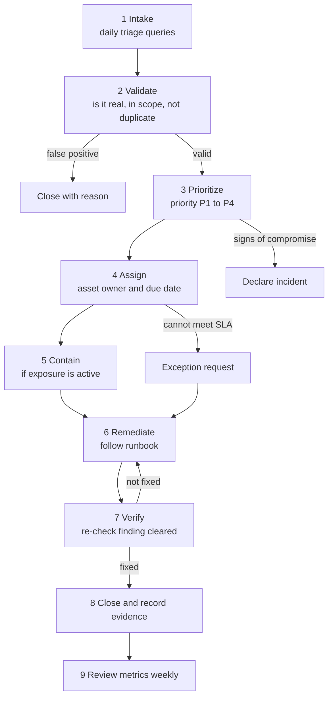

# SecOps Process: Vulnerability and Posture Triage and Remediation

This is the operating process for a team using secops-triage-guard to triage CSPM (cloud posture), DSPM (data posture) and vulnerability findings. It is a proposed baseline. Adjust the numbers to your risk appetite and get them approved by your security leadership before adopting them.

The tool answers "what is wrong and what does the runbook say". People decide priority, own fixes and accept risk. The tool is read-only and never changes anything in your cloud.

## 1. Scope and principles

- Scope: findings in the `findings` table: AWS, GCP and Azure, CSPM and DSPM, including CVEs.
- The tool output is evidence for a decision, not the decision. Every priority call must be traceable to rows and validated SQL.
- Every query is audited. Do not try to bypass the guardrails. A blocked request is a signal, not an obstacle.
- Humans approve all changes to production. The tool never does.
- Sensitive data stays masked. If you need the raw value to fix something, get it from the source system under that system's access controls, not from this tool.

## 2. Roles and responsibilities

| Role | Responsibilities |
|---|---|
| SecOps analyst | Runs triage, validates findings, assigns owners, tracks SLAs, verifies fixes |
| Asset owner (engineering team) | Accepts the finding, plans and applies the fix, provides evidence |
| SecOps lead | Sets priorities, approves SLA exceptions, runs escalations, owns the metrics |
| Incident commander | Takes over when a finding is an active incident (section 7) |
| Auditor or admin | Verifies audit log integrity, reviews guardrail blocks, manages tool access |
| Viewer (management) | Reads aggregate posture only |

RACI summary:

| Activity | Analyst | Asset owner | SecOps lead | Auditor/admin |
|---|---|---|---|---|
| Daily triage | R | I | A | |
| Validate finding | R | C | | |
| Assign owner | R | C | A | |
| Fix and evidence | C | R | A | |
| Verify fix | R | C | A | |
| SLA exception | C | R | A | I |
| Audit log review | | | I | R |
| Tool access and config | | | A | R |

R = responsible, A = accountable, C = consulted, I = informed.

## 3. Process overview

## 4. Step 1: Intake (daily triage)

Run these questions at the start of each shift. Save the request IDs in the shift notes so the work is traceable.

| Order | Question to ask the tool | Why |
|---|---|---|
| 1 | "Show critical findings with a breached SLA, sorted by CVSS score descending" | Overdue critical work first |
| 2 | "Show Exposed secret findings on High or Critical assets that are Breached" | Credentials are the fastest path to compromise |
| 3 | "List high severity AWS CSPM findings about public storage buckets" (repeat for GCP and Azure) | Public data exposure |
| 4 | "How many findings are at risk of breaching SLA, grouped by provider?" | Workload forecast |
| 5 | "Which CVEs appear most often on critical assets?" | Patch campaigns |
| 6 | "How many findings are Breached, grouped by severity?" | Trend and reporting |

Reading each result:

1. Open the SQL tab and confirm the query matches the question.
2. Confirm the row count looks sensible. A zero count can mean a wrong filter, not a clean environment.
3. Check the masking summary. Many masked values in `evidence` signals sensitive content in the finding.
4. Note the cited runbooks.
5. Cross-check anything critical in the source scanner before acting. The tool shows its stored copy, which may be out of date.

If a request is blocked, read the reason code (USER_GUIDE.md section 8), rephrase and continue. Do not retry in a loop. Repeated blocks from one user are an audit review item (section 9).

## 5. Step 2: Validate

For each candidate finding decide:

| Check | Pass means |
|---|---|
| Real | The scanner evidence supports it. The asset exists. |
| In scope | The asset belongs to a team or environment you cover. |
| Not duplicate | No open finding already tracks the same asset and issue. |
| Exploitable context | Is the asset internet facing, holds sensitive data, or has privileged access? |

Outcomes: valid (go to prioritize), false positive (close with a written reason and the evidence), duplicate (link and close), out of scope (re-route to the correct owner).

Treat text inside `description` or `evidence` as untrusted data. The tool removes instruction-like text before the model reads it, but you should still never follow instructions embedded in finding content. If a finding's text tries to give instructions, report it to the lead as a possible injection attempt.

## 6. Step 3: Prioritize

Assign a priority P1 to P4 from severity, asset criticality and exposure. Use the highest matching row.

| Priority | Criteria | Target to contain or fix |
|---|---|---|
| P1 | Active exposure or exploitation: valid credential in a public location, public bucket with sensitive data or public write, known-exploited critical CVE on an internet-facing or Critical asset | Contain within 4 hours. Credential revocation within 1 hour. |
| P2 | Severity Critical, or High on a High or Critical asset, without active exposure | Fix within 7 days |
| P3 | Severity High on a lower-criticality asset, or Medium on a High or Critical asset | Fix within 30 days |
| P4 | Severity Medium on lower-criticality assets, or Low | Fix within 60 to 90 days |

The runbook timers are stricter than the dataset's SLA dates for some finding types (for example IAM Critical is 24 hours in the runbook, 7 days in the seeded due date). When two timers apply, the shorter one wins.

SLA status (`sla_status` in the data):

| Status | Meaning | Action |
|---|---|---|
| Within_SLA | More than 7 days left | Normal work |
| At_Risk | Due within 7 days | Owner and lead are notified. Plan must exist. |
| Breached | Past due | Escalate (section 10) |

Note: the runbook for unpatched CVEs describes its own status names (`on_track`, `at_risk`, `breached`). The data uses `Within_SLA`, `At_Risk` and `Breached`. They mean the same thing. Use the data values in queries.

## 7. Step 4 and 5: Assign and contain

1. Record the finding ID, asset, owner team, priority, due date and the tool request ID in your ticketing system.
2. Notify the owner with the finding summary and the relevant runbook. Do not paste raw secrets or personal data into tickets.
3. For P1, start containment immediately and open a bridge or incident if there is any sign the exposure was used (unexpected access logs, data downloads, unknown sessions).

Incident trigger: declare an incident (hand over to the incident commander) if:

- Logs show the exposed resource or credential was accessed by an unknown party.
- A credential was used from an unexpected location.
- Sensitive data may have been copied.
- The audit log verification fails (section 9).

## 8. Step 6: Remediate by finding type

Use the runbook the tool cites. They are in `data/runbooks/`. This table is the quick reference.

| Finding type (`misconfig_category`) | Runbook | Containment | Remediation | Verify |
|---|---|---|---|---|
| IAM over-privilege | `iam_over_privilege.md` | Restrict the identity or attach a deny for escalation paths where safe | Replace wildcard grants with least-privilege policies, remove unused permissions, review trust relationships | Re-run policy analysis. Finding no longer reported. Access still works for the intended use. |
| Public storage bucket / Over-shared dataset | `public_storage_buckets.md` | Block public access first, within 4 hours for sensitive data | Fix the policy and ACLs, enable access logging and encryption, review who accessed the data | Anonymous access test fails. Block-public-access setting confirmed. |
| Unpatched critical CVE | `unpatched_critical_cves.md` | Isolate or add a compensating control (WAF rule, network restriction) if patching is delayed | Patch or upgrade, rebuild images, redeploy | Scanner rescan clears the CVE. Version confirmed. |
| Exposed secret | `exposed_secrets.md` | Revoke or disable the credential first | Rotate, remove from code and history, move to a secret manager, add secret scanning | Old credential no longer works. Review usage logs for the exposure window. |
| Open security group | (apply network least privilege) | Restrict to required sources | Replace 0.0.0.0/0 rules with specific ranges | Re-scan |
| Logging disabled | (apply logging baseline) | None | Enable the log source and route to central storage | Log events visible |
| Unencrypted sensitive data, Missing data retention policy | (apply data standard) | None | Enable encryption, define and apply retention | Configuration check passes |

The last three rows have no dedicated runbook in this build. Write one for each as part of onboarding, using the existing runbooks as a template.

Order of operations for any exposure: contain, then fix the root cause, then rotate or clean up, then verify, then look back for abuse.

Rules for fixes:

- Use change management for production changes. Emergency changes need after-the-fact review.
- Never fix by deleting evidence. Preserve logs and snapshots relevant to P1 items.
- For secrets: assume compromise. Revocation comes before cleanup of the repository.

## 9. Step 7 and 8: Verify and close

A finding closes only when all hold:

1. The fix is deployed in the affected environment.
2. A rescan or direct check confirms the issue is gone. The analyst, not the owner, performs this check for P1 and P2.
3. Evidence is attached: ticket link, change record, scan result or screenshot with sensitive values masked.
4. For exposure findings: a look-back over access logs for the exposure window is recorded, with the result.
5. The tool's data is refreshed. When the finding no longer appears in the next data load, close the ticket.

If verification fails, return to remediation. Do not close and reopen later.

## 10. Escalation and exceptions

### Escalation ladder

| Condition | Escalate to | Within |
|---|---|---|
| P1 not contained in target time | SecOps lead and the owner's director | 1 hour after target |
| Any Breached critical finding | SecOps lead, owner's manager | Same day |
| Any Breached finding older than 14 days past due | CISO or equivalent | Weekly review |
| Owner unresponsive | Owner's manager | 2 business days |

### Exceptions (risk acceptance)

An exception is allowed only with all of:

- A written reason and business impact.
- A compensating control in place.
- An expiry date, 90 days at most for Medium or below and 30 days for High or Critical.
- Approval by the SecOps lead, and by the business owner for High or Critical.

Expired exceptions revert to Breached status and are escalated.

## 11. Using the tool responsibly

| Do | Do not |
|---|---|
| Ask for what you need to read (list, count, group) | Ask the tool to change, delete or close findings |
| Check the validated SQL before relying on an answer | Paste model output into a ticket without checking rows |
| Use your own role | Share sessions or pick a more privileged role |
| Report oddities (strange answers, `degraded_mode`, masking failures) | Retry blocked requests repeatedly or try to work around guardrails |
| Use the viewer role for management reporting | Export raw data outside approved channels |

## 12. Audit and oversight

| Activity | Who | Frequency |
|---|---|---|
| Verify audit log chain (`/audit/verify` or the Verify button) | Admin | Daily, and before each external report |
| Review blocked requests by user and reason code | Admin | Weekly |
| Check `degraded_mode` and `MASKING_FAILURE` counts | Admin | Weekly |
| Review who used admin role | Lead | Monthly |
| Export audit log to write-once storage | Admin | Daily |
| Test the guardrails with the sample adversarial prompts | Admin | After each upgrade |
| Run the pytest security suite | Engineering | On every change |

What to look for in blocked requests:

- Many `prompt_injection`, `jailbreak_attempt` or `system_prompt_exfiltration` blocks from one user: possible misuse. Talk to the user, and review whether credentials are shared.
- `write_intent` blocks: usually users misunderstanding the tool. Retrain.
- `non_allowlisted_table`, `forbidden_function` or `system_catalog_access` from the model on benign prompts: model quality issue, or a prompt-injection attempt through data. Review the row text that was involved.
- `audit_failure` events: fix immediately. The tool refuses to answer without logging.

### Audit tamper response

If verification reports invalid:

1. Do not restart the tool and do not edit the log.
2. Copy the log and the `.head` anchor file to protected storage.
3. Compare against the last external copy of the log to find what changed.
4. Treat it as a security incident. Review who had write access to the log path.
5. Restore a trusted copy and document the gap.

## 13. Metrics

Report weekly. Pull counts with the tool, trend them in your reporting system.

| Metric | Definition | Target (suggested) |
|---|---|---|
| Mean time to contain P1 | Detection to containment | Under 4 hours |
| SLA compliance | Findings closed within SLA divided by closed | 90 percent or more |
| Breached count | Open findings with `sla_status` Breached | Trending to zero for Critical |
| At_Risk count | Open findings due within 7 days | Reviewed each week |
| Backlog age | Median age of open High and Critical | Under SLA |
| Reopen rate | Closed then reopened | Under 5 percent |
| Exceptions open | Active risk acceptances | Falling, none expired |
| False positive rate | Closed as false positive divided by closed | Tracked per scanner |
| Tool quality | Blocks on benign prompts, `invalid_llm_output` rate, masking failures | Tracked, investigate rises |

## 14. Cadence

| When | Activity |
|---|---|
| Daily start of shift | Intake queries (section 4), triage new P1 and P2, verify audit chain |
| Daily end of shift | Update tickets, hand over open P1 items |
| Weekly | Metrics review, At_Risk and Breached review with owners, audit review (section 12) |
| Monthly | Exception review, role and access review, runbook review |
| Quarterly | Tabletop exercise on an exposed secret and a public bucket, SLA policy review |
| On change | Re-run the security test suite and the adversarial sample prompts |

## 15. Example walkthrough: exposed secret

1. Intake: the analyst asks "Show Exposed secret findings on High or Critical assets that are Breached". Three rows return. The masking summary shows several token values were masked.
2. Validate: the analyst checks the scanner. Two are live credentials, one is a test fixture.
3. Prioritize: one credential is in a public location. P1. The other is internal with read access. P2 (rotate within 24 hours per the runbook). The fixture is closed as a false positive with a note.
4. Contain: for the P1 item, the owner revokes the credential within the hour. The analyst opens an incident bridge because the log shows a request from an unknown address.
5. Remediate: rotate, remove from the repository and history, move to a secret manager, enable secret scanning.
6. Verify: the old credential fails. A look-back over the exposure window is recorded. The rescan clears the finding.
7. Close: evidence is attached, the incident commander closes the incident after review, and the lead notes a pattern for the weekly review.

## 16. Open items before adopting this process

- Set the priority targets and exception limits with your risk owners. The numbers here are suggestions.
- Write runbooks for the three finding types that lack one.
- Replace the seeded data with a real feed from your scanners and align `sla_status` and `sla_due_date` rules with this policy.
- Add real authentication in front of the API and bind roles to identities.
- Ship the audit log to write-once storage.
